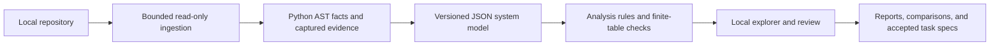

# code-form

**Make software systems explicit, inspectable, and improvable.**

The intended core is mathematical verification and repair: given explicit
assumptions and supported program semantics, establish precise properties,
explain their dependencies, and help fix violations against the same
specification. See the [verification design](docs/formal-verification.md).

code-form turns a Python repository into a versioned, evidence-linked system
model and a local application for exploring it. Follow dependencies, inspect
claims against captured source, review findings, compare snapshots, and export
bounded change tasks.

**Status: working local first release.** Analysis uses Python's AST and
deterministic rules. No API key, cloud service, or third-party runtime package
is required. This release is the observation and review foundation.
An optional pinned Lean checker now verifies a narrow integer-transfer adapter
and explicit finite workflow models. The Proofs & mathematics view exposes
assumptions, complete proof source, axiom dependencies, counterexamples, and
repair comparisons. General symbolic Python reasoning and automatic repair
execution remain future work.

## Run locally

Python 3.11 or newer is required. Run from this checkout.

Windows / PowerShell:

```powershell
python -m venv --without-pip .venv
.\.venv\Scripts\python.exe -m codeform serve --demo
```

macOS / Linux:

```bash
python3 -m venv --without-pip .venv
.venv/bin/python -m codeform serve --demo
```

Open **http://127.0.0.1:7331**. `--demo` analyzes five example repositories
before startup. Use the snapshot selector to switch examples, or
**Analyze repository** to choose another Python repository.
The default **Start here** view presents documented purpose, supported
mathematical model excerpts, LaTeX notation, scenarios, and Lean/source evidence.
See [the walkthrough guide](docs/math-first-walkthrough.md).

On Windows, `.\scripts\setup.ps1` creates the environment and
`.\scripts\start.ps1` starts the demo. Activation and installation are optional.
The environment uses `--without-pip` because the app needs no installed packages.

The UI analyzes directories inside its allowed workspace, which defaults to
the current directory. To browse sibling projects while keeping storage local:

```powershell
.\.venv\Scripts\python.exe -m codeform serve --workspace .. --data-dir .codeform/projects
```

Add `--port 7332` if the default port is occupied. Stop with Ctrl+C.
The server binds to loopback and is intended for a single local reviewer.

The [operations guide](docs/operations.md) covers setup, health checks, shutdown,
restart, storage configuration, backup/restore, updates, and troubleshooting.
To reopen the demo storage used during development, add
`--data-dir .codeform/demo`. Reload the browser after restarting.

## What you can do

| View | Behavior |
| --- | --- |
| Start here | Guided purpose → mathematical objects → intended properties → examples → argument → Lean and source. |
| Analysis DAG | Pinned workflow runs, parallel-ready tasks, role prompts, immutable artifacts, validation, and human gates. |
| Overview | Repository metadata, model counts, dependency map, and priority findings. |
| Architecture | Module imports, resolved calls, direct test references, and component source. |
| Claim ledger | Search statements, filter epistemic status, and open supporting evidence. |
| Findings | Filter severity and review status; annotate, accept, dismiss, or resolve findings. |
| Behavior | Lexical call flows, explicit transition tables, finite invariant checks, and Lean candidates. |
| Proofs & mathematics | Locally checked Lean theorems, assumptions, derivation steps, counterexamples, proof dependencies, and source/model boundaries. |
| Agent workspace | External agent attempts, diagnostics, evidence-linked drafts, and separate review history. |
| Compare | Source and model changes between snapshots of the same directory. |
| Export / import | JSON bundles, Markdown reports, Mermaid diagrams, and validated bundle import. |
| Change tasks | Accepted findings become scoped task specifications with evidence and acceptance criteria. |

Snapshots contain captured source text, source hashes, a repository content
hash, Git commit and working-tree metadata, analyzer/runtime versions, and
stable entity IDs. Review writes separate annotations; it does not change
the generated model. Task export does not execute changes.

## Example repositories

| Repository | What to investigate |
| --- | --- |
| [payment-service](examples/payment-service) | Routes, persistence, direct test gaps, a swallowed failure, and documented `POST /refunds` without a matching route. |
| [order-workflow](examples/order-workflow) | A terminal state can be reopened. The finite table yields a counterexample and an unchecked Lean candidate. |
| [cyclic-service](examples/cyclic-service) | A dependency cycle with a deferred import, broad exception handling, and an untested deletion interface. |
| [verified-transfer](examples/verified-transfer) | Four Lean-checked conclusions and two checked counterexamples; compare an overdraft bug with a guarded implementation. |
| [verified-workflow](examples/verified-workflow) | A Lean induction proof that terminal states stay unchanged through every finite event sequence. |

These standalone codebases have passing standard-library tests and intentional
findings. Passing tests do not establish omitted requirements.
See the [testing guide](docs/testing.md) for an exercise including editing a
copy and comparing snapshots.

## Run the mathematical demo

On Windows, install the pinned Lean compiler into the checkout:

```powershell
.\scripts\setup-lean.ps1
.\.venv\Scripts\python.exe -m codeform serve --demo --data-dir .codeform/math-demo --port 7332
```

Open **http://127.0.0.1:7332**, select `verified-transfer`, open
**Proofs & mathematics**, and click **Check proofs with Lean**.
Inspect the unchecked function's counterexample, then the guarded function's
conservation, nonnegativity, and composed safety theorems.
Select `verified-workflow` for a proof by induction over event sequences.

The proof checker uses Lean 4.19.0 and its bundled `Std` library. It does not
require Mathlib or a remote AI service. On macOS/Linux, install that pinned Lean
version and pass its executable with `serve --lean /path/to/lean`, or put it
on `PATH`. See [proof checking operations](docs/proof-checking.md).

CLI verification uses the same model and checker:

```powershell
.\.venv\Scripts\python.exe -m codeform verify examples/verified-transfer --store .codeform/math-demo --output .codeform/transfer-proofs.json
```

Exit code `2` means a checked counterexample was found, `1` means checking was
unavailable/unsupported/failed, and `0` means all generated obligations were
proved. Proof reports are separate from immutable analysis bundles.

## API for external reasoning agents

The [v1 API](docs/api.md) exposes snapshots, captured source, fixed obligations,
checker attempts, diagnostics, and reviewable proposals. An external agent
supplies the model connection; code-form requires no model API credentials.
The API is the common surface for the UI, CLI client, Python client, and
future MCP/Codex adapters.

```powershell
.\.venv\Scripts\python.exe -m codeform api --url http://127.0.0.1:7332 capabilities
.\.venv\Scripts\python.exe examples/agent_client_demo.py --url http://127.0.0.1:7332
```

The authored client demo checks a fixed goal, reads diagnostics, retries, and
saves a draft repair visible in **Agent workspace**. It does not call a model
or edit source. OpenAPI is served at `/api/v1/openapi.json`.

The [DAG workflow](docs/workflow-dag.md) coordinates those tools by dependency:
facts and requirements → model draft → human review → parallel analysis roles
→ validation → synthesis → human proposal review. Built-ins run locally;
external agent nodes explicitly wait for submissions.

## CLI

```powershell
.\.venv\Scripts\python.exe -m codeform analyze examples/payment-service --output .codeform/exports/payment
.\.venv\Scripts\python.exe -m codeform validate .codeform/exports/payment/bundle.json
.\.venv\Scripts\python.exe -m codeform compare before/bundle.json after/bundle.json
```

`analyze` saves a snapshot under `.codeform/`. `--output` also writes
`bundle.json`, `report.md`, `architecture.mmd`, `sequence.mmd`, and proposed
`.lean` files. `--store` selects another snapshot directory.
When installed as a package, `code-form` is equivalent to `python -m codeform`.
Running from the checkout needs no installation.

## Verify

```powershell
.\.venv\Scripts\python.exe -m unittest discover -s tests -v
node --check codeform/web/app.js
```

The suite checks deterministic analysis, valid evidence, relative/aliased
imports, target-code non-execution, invalid input, finite-model counterexamples,
comparison, review persistence, and the HTTP analysis/review/export journey.
Temporary files stay inside `.codeform/test-tmp`.

An optional Playwright acceptance test covers the rendered app, downloads,
re-analysis, comparison, imports, reloads, filters, and mobile layout.
See [docs/testing.md](docs/testing.md).
CI runs core checks on Windows and Linux with Python 3.11 and 3.14.

## Analysis boundaries

- Target source is parsed, never imported or executed. The app never runs
  target tests, installs dependencies, or invokes repository scripts.
- Static resolution is limited. Dynamic dispatch, reflection, conditional
  imports, router prefixes, and generated routes require investigation.
- Direct test references describe explicit calls, not execution or coverage.
  Findings are review candidates, not automatic defect verdicts.
- Precise documentation contracts use `API: METHOD /path` in Markdown.
  Ordinary prose is not interpreted as an implementation requirement.
- State machines use a literal `TRANSITIONS = {("state", "event"): "next"}`
  table and optional `TERMINAL_STATES`. Checks establish properties of that
  finite table only.
- Legacy analysis Lean candidates contain a marked `sorry` placeholder and are
  never labeled `proved`. Optional verification generates separate complete
  proofs, runs Lean, and checks transitive axiom dependencies before recording
  a result. The Proofs view distinguishes these from unchecked candidates.
- Checked results concern the emitted mathematical semantics. The narrow source
  adapter is a trusted bridge, not a formally verified Python compiler.
- Ingestion limits are 2,000 eligible files, 256 KB per file, and 16 MB total.
  Build/environment directories, sensitive filenames, symbolic links, and
  Windows junctions are excluded. Eligible code may still contain inline
  secrets; exported snapshots include that source.

## Design

The smallest useful unit is an **inspectable claim**: a precise statement,
an epistemic label, and evidence tied to a captured snapshot. Architecture,
findings, and formal candidates are derived views sharing that evidence boundary.



Read [verification and repair](docs/formal-verification.md),
[math-first walkthrough](docs/math-first-walkthrough.md),
[agent API](docs/api.md),
[operations](docs/operations.md), [implementation architecture](docs/architecture.md),
[system model](docs/system-model.md), [change policy](docs/agent-safety.md),
and the [roadmap](ROADMAP.md) for extension boundaries.

## License

MIT. See [LICENSE](LICENSE).
