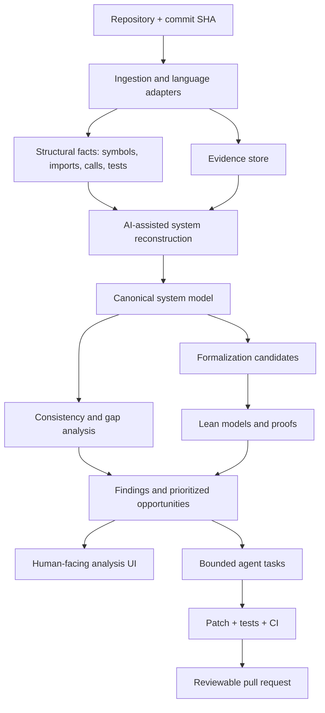

# code-form

**Make software systems explicit, inspectable, and improvable.**

code-form explores how AI can reconstruct a codebase as an evidence-linked system model, analyze that model, formalize selected properties, and help engineers make safer changes.

> **Status:** Early prototype. The initial CLI is a deterministic, read-only structural inventory, not a complete architecture reconstruction or source-code verifier.

## Quick start

Requires Python 3.10 or newer. The core CLI has no runtime dependencies.

```bash
python -m pip install -e .
code-form analyze .
```

Write the JSON bundle to a file:

```bash
code-form analyze . --output code-form-report.json
```

Or run without installing:

```bash
PYTHONPATH=src python -m code_form.cli analyze . --output code-form-report.json
```

The analyzer does not import or execute code from the repository being analyzed. It inventories files, parses Python syntax with the standard-library AST, records declarations and best-effort internal import edges, identifies main guards and likely test paths, and emits JSON with evidence references and a Mermaid dependency graph.

## First analyzer output

- Repository path, Git commit/branch, and working-tree status when available.
- File inventory, language counts, sizes, line counts, and SHA-256 hashes.
- Python functions/classes and import statements with file/line evidence.
- Best-effort internal Python import edges.
- Observed main guards and Python parse errors, explicitly labeled as observations.
- Mermaid dependency graph and machine-readable JSON bundle.

Only Python is structurally parsed. Other file types are inventoried but not semantically analyzed. Import resolution does not capture every dynamic or runtime relationship.

## Broader workflow

1. **Ingest** a repository, its tests, configuration, dependency metadata, and documentation.
2. **Reconstruct** an evidence-linked model of its architecture and behavior.
3. **Analyze** the model for contradictions, missing tests, unclear assumptions, and candidate design improvements.
4. **Formalize** selected claims and invariants in a machine-checkable form where practical.
5. **Explore** the model and findings in a UI.
6. **Propose changes** through isolated agent tasks, tests, patches, and reviewable pull requests.

## Design principles

- **Evidence before confidence.** Material claims should point to source, tests, configuration, or explicitly marked inference.
- **Separate fact from hypothesis.** Observed code, inferred intent, proposed requirements, and proven properties are different things.
- **Formalize selectively.** Use Lean where a precise model and proof are worth the cost.
- **Keep the model versioned.** Tie a model to a repository revision and make it diffable across commits.
- **Human approval for consequential changes.** Agents can investigate and propose; merging and deployment remain governed by repository policy.
- **Treat repositories as untrusted input.** Do not execute project code or agent-generated commands without sandboxing and explicit controls.
- **Make uncertainty visible.** A missing proof is not a failed proof; a passing test is not a universal correctness guarantee.

## Proposed architecture



## What code-form is not

- Not a guarantee that an LLM understands an entire repository.
- Not a replacement for tests, code review, static analysis, or security review.
- Not a claim that generated diagrams are automatically correct.
- Not an automatic source-to-Lean verifier.
- Not an autonomous agent with unrestricted write or deployment access.

## Roadmap and contributing

See [ROADMAP.md](ROADMAP.md) and [docs/system-model.md](docs/system-model.md). Early feedback is especially useful on evidence design, model accuracy, supported languages, evaluation methods, and realistic Lean proof targets.

## License

MIT. See [LICENSE](LICENSE).
