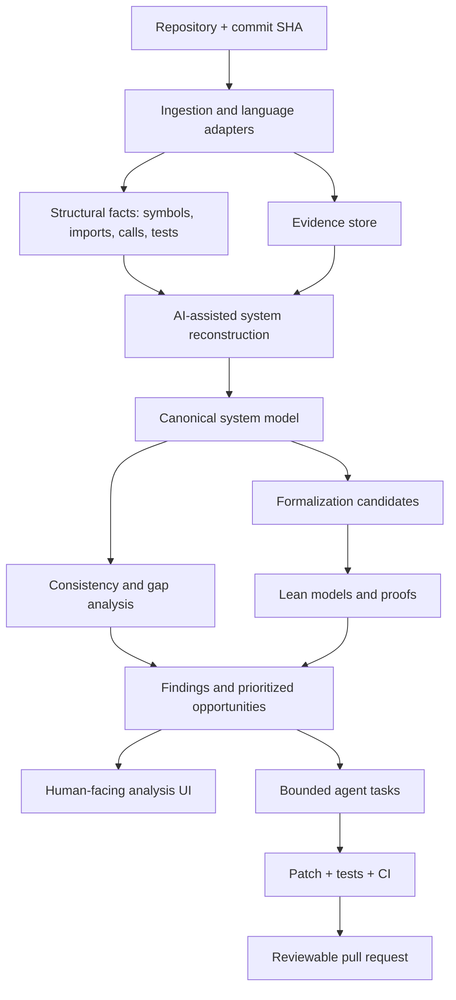

# code-form

**Make software systems explicit, inspectable, and improvable.**

code-form is an open-source project exploring how AI can reconstruct a codebase as an evidence-linked system model, analyze that model, formalize selected properties, and help engineers make safer changes.

Instead of jumping directly from source code to code edits, code-form introduces an intermediate representation of the system: components, interfaces, data flows, state machines, assumptions, invariants, requirements, and evidence.

> **Status:** Early concept / design-stage scaffold. Nothing in this repository currently claims to prove arbitrary source code correct.

## The workflow

1. **Ingest** a repository, its tests, configuration, dependency metadata, and documentation.
2. **Reconstruct** an evidence-linked model of its architecture and behavior.
3. **Analyze** the model for contradictions, missing tests, unclear assumptions, and candidate design improvements.
4. **Formalize** selected claims and invariants in a machine-checkable form where practical.
5. **Explore** the model and findings in a UI.
6. **Propose changes** through isolated agent tasks, tests, patches, and reviewable pull requests.

## Design principles

- **Evidence before confidence.** Every material claim should point to source locations, tests, configuration, or an explicitly marked inference.
- **Separate fact from hypothesis.** Observed code, inferred intent, proposed requirements, and proven properties are different things.
- **Formalize selectively.** Use Lean for properties where a precise model and proof are worth the cost; do not force every architectural observation into theorem proving.
- **Keep the model versioned.** A model is tied to a repository revision and should be diffable across commits.
- **Human approval for consequential changes.** Agents can investigate and propose; merging and deployment remain governed by repository policy.
- **Treat the repository as untrusted input.** Do not execute project code or agent-generated commands without sandboxing and explicit controls.
- **Make uncertainty visible.** A missing proof is not a failed proof; a test passing is not a universal correctness guarantee.

## Proposed architecture



## A possible first milestone

Build a **read-only CLI** for one language and one repository:

```bash
code-form analyze .
```

It should emit a versioned bundle containing:
- repository and commit metadata;
- a component/dependency graph;
- Mermaid architecture and sequence diagrams;
- a claim ledger with evidence references and confidence;
- assumptions, invariants, and open questions;
- findings with severity, rationale, and reproducible evidence;
- suggested tests and candidate properties for later formalization.

Do not begin with autonomous PR generation. First demonstrate that the reconstructed model is useful, traceable, and stable across repeated runs.

## Suggested initial stack

Keep this provisional until the first language and use case are chosen.

- **CLI / core:** Python or TypeScript; choose one and keep the core deterministic where possible.
- **Structural extraction:** language-native parsers and existing static-analysis tools rather than relying on an LLM to infer all code relationships.
- **Model format:** versioned JSON Schema, with Markdown/Mermaid as generated views.
- **Formal layer:** Lean 4 for carefully scoped models and proofs.
- **UI:** a local web application that reads analysis bundles before introducing a persistent backend.
- **Agent execution:** isolated worktrees or sandboxes, bounded permissions, explicit budgets, tests, and human-reviewed PRs.

## What code-form is not

- Not a guarantee that an LLM understands an entire repository.
- Not a replacement for tests, code review, static analysis, or security review.
- Not a claim that diagrams generated from source are automatically correct.
- Not an automatic source-to-Lean verifier in its initial form.
- Not an autonomous agent with unrestricted write or deployment access.

## Roadmap

See [ROADMAP.md](ROADMAP.md) and [docs/system-model.md](docs/system-model.md).

## Contributing

Early feedback is especially useful on:
- which claims should be represented in the canonical model;
- how evidence should be linked to source code;
- which language should be supported first;
- how to evaluate model accuracy and usefulness;
- which properties are realistic candidates for Lean.

## License

MIT. See [LICENSE](LICENSE).
