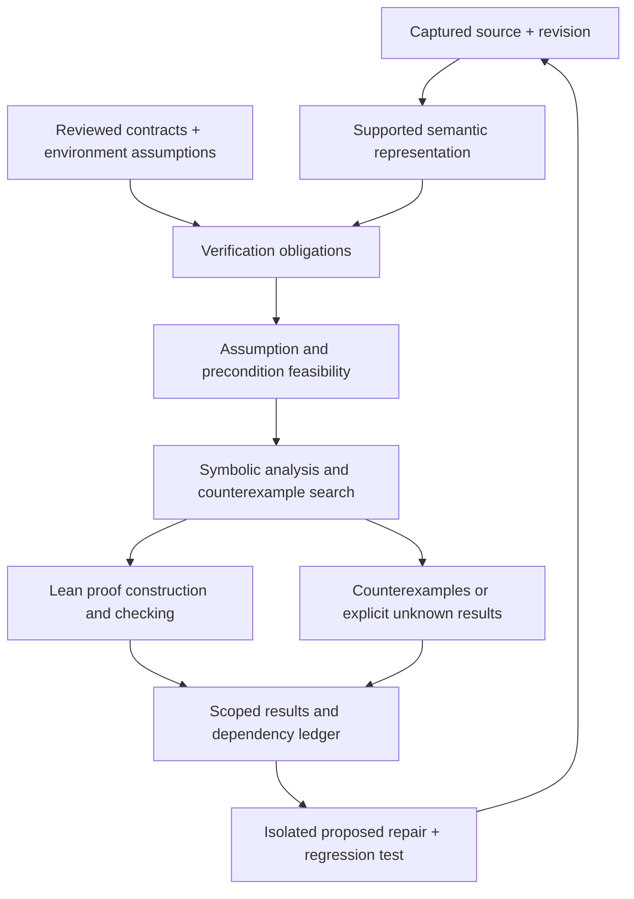

# Mathematical verification and repair

## Product direction and current status

Implementation tracking:
[issue #2](https://github.com/qzyu999/code-form/issues/2).
This document specifies the target and first milestone; completing the
design does not complete the implementation issue.

code-form's intended core is a reasoning engine that can establish precise
software properties from explicit assumptions and program semantics, explain
the dependency of each conclusion, and help repair implementations that
violate their specifications.

The current release provides repository ingestion, static structural facts,
captured evidence, review, and snapshot comparison. It checks terminal-state
properties of literal finite tables and exports unchecked Lean candidates
containing `sorry`. It does not run Lean, reason symbolically about Python
functions, prove implementation refinement, or generate verified repairs.
Those features must be implemented before the application can make the
guarantees described below.

[Axiom's mission](https://axiommath.ai/mission/) motivates a
conjecture–prove–verify loop, and [AXLE](https://axle.axiommath.ai/) provides
tools for manipulating and checking Lean proofs. For software, the loop also
needs precise contracts and a justified connection between formal semantics
and the source being changed. This proposal does not depend on access to
Axiom services or promise their research capabilities.

## What a conclusion means

The unit of verification is a scoped obligation:

```text
environment assumptions
+ supported implementation semantics
+ preconditions
=> postcondition / invariant
```

A result must answer: which property, which source revision, under which
assumptions, with which semantics, checked by which tool, and with which
remaining trust boundary?

"The codebase is coherent" is too broad to serve as a theorem. Useful
properties include preservation of an account balance sum, nonnegative
balances, legal workflow transitions, authorization before a protected
operation, and absence of specified exceptional outcomes.

Whole-system conclusions require composition. If the initial state satisfies
an invariant and every reachable operation preserves it, induction can
establish the invariant for every finite reachable execution. That argument
must enumerate the allowed operations and environment behaviors, including
failure paths. A list of successful function checks alone does not establish
a system theorem.

## Separate definitions, assumptions, and obligations

| Item | Meaning | Example |
| --- | --- | --- |
| Definition | Precise meaning of a modeled object or operation. | Balances are integer cents; transfer subtracts from the source and adds to the destination. |
| Foundational axiom | A dependency of the chosen formal logic and libraries. | Lean's accepted foundational axioms, reported by the proof checker. |
| Environment assumption | A condition supplied by the operating environment. | Database updates commit atomically. |
| Preconditions | Conditions callers must establish for an operation. | Amount is positive and does not exceed the source balance. |
| Invariant | A requirement that must hold at a stated boundary. | Account balances never become negative. |
| Theorem | A checked conclusion derived from definitions and stated hypotheses. | A successful transfer preserves the sum of balances. |
| Counterexample | A witness that violates a specific obligation under its assumptions. | An insufficient-funds request returns a negative balance. |

A business requirement is not a universal mathematical axiom. Declaring
"terminal states never reopen" as an assumption would bypass the behavior we
want to verify. It should be an obligation against the transition semantics.
An AI-proposed contract remains proposed until reviewed.

Likewise, code-form must not silently strengthen a precondition or weaken a
postcondition to make a faulty implementation pass. A specification amendment
is a separate versioned change with its own rationale and approval.

## First end-to-end milestone

Build a verification slice for pure Python integer functions and explicit
finite transition models. Demonstrate a failure, a counterexample, a proposed
repair, and successful re-verification of the unchanged requirement.

### Integer-transfer example

The first example uses a pure function rather than a real database:

```python
def transfer(source: int, destination: int, amount: int):
    if amount <= 0:
        raise ValueError("Amount must be positive")
    return source - amount, destination + amount
```

For exact built-in integer inputs and initially nonnegative balances, specify:

- successful return implies both resulting balances are nonnegative;
- successful return preserves `source + destination`;
- invalid amounts must be rejected without producing a successful result.

The faulty implementation admits `source=10`, `destination=0`, `amount=11`,
returning `(-1, 11)`. Conservation holds, but nonnegativity and the required
rejection behavior fail. A proposed repair adds an insufficient-funds guard.
Re-check all obligations against the original contracts and source hashes.

A separate conditional theorem may use the precondition `amount <= source`.
Its successful proof must not obscure the failing public-input obligation.
The example represents distinct account balances as independent values;
aliasing, transactions, and persistence are outside this initial model.

### Supported semantics

Define and document a deliberately small language fragment before claiming
source-level verification:

- exact built-in integers and booleans, with arbitrary-precision integer
  arithmetic matching Python's mathematical values;
- explicit arguments, local assignments, addition, subtraction, comparisons,
  boolean operations, conditionals, tuple returns, and specified rejection;
- no loops, recursion, mutation of shared objects, floating point, reflection,
  user-defined operator overloads, imports executed by the verifier, or I/O;
- every statement and expression in the verified function must be represented.

Annotations alone do not ensure exact integer inputs. Type assumptions must
be explicit or justified by runtime guards/caller contracts. Python booleans
and custom numeric objects must not silently receive integer semantics.

Translate supported source into an intermediate representation carrying source
ranges and an explicit normal/exceptional outcome. Refuse unsupported nodes
or calls with `unsupported`, rather than skipping them or substituting an
unconstrained success. Loop and recursion support later require termination
arguments or clearly bounded exploration.

### Source-to-model boundary

Source references establish provenance, not semantic equivalence. Record the
source hash, parser/runtime version, translator version, the emitted semantic
representation, and its hash for every obligation.

The first milestone may trust a small audited translator and explicitly state
that trust. Its regression suite should exercise supported Python outcomes
against the semantics using only the project's authored fixtures.
Such tests increase confidence but do not prove the translator correct.

A stronger milestone formalizes the intermediate language and proves the
translation/refinement obligations, or checks a translation certificate.
A Lean theorem about generated arithmetic must never be advertised as a
proof about arbitrary Python merely because line numbers are attached.

## Verification pipeline



1. Validate contract syntax and symbol references. Contracts are data,
   not arbitrary repository expressions evaluated by the application.
2. Check assumption and precondition feasibility where supported. Contradictory
   hypotheses or unreachable preconditions must be surfaced before presenting
   a successful implication as a useful guarantee.
3. Generate path conditions and obligations over normal and rejected outcomes.
   Specify whether a result concerns partial correctness, total correctness,
   or a bounded execution.
4. Use an SMT solver for suitable decision procedures and counterexample search.
   Report `unknown`, timeout, and unsupported theories without upgrading them.
5. Produce and check Lean proofs for supported obligations and reusable
   mathematical theories. SMT output is not automatically a Lean certificate.
   If replay into Lean is supported, retain the replay and checker evidence.
6. Record exact tool versions, input and output hashes, theorem names,
   dependencies, commands, return codes, and diagnostics.
7. Re-run obligations when their source, contract, theory, assumptions, or
   toolchain changes. Previous results remain evidence for their original scope.

General consistency checking is undecidable. Feasibility checks cover only
the supported theories and must report unknown outside them. A verified
implication can still be vacuous; the application must distinguish that from
a useful guarantee with an established feasible precondition.

## Lean checking and trusted dependencies

Pin a Lean toolchain and dependencies. Checked proofs must contain no `sorry`,
`admit`, or dependency on `sorryAx`. Passing Lean compilation by itself is
insufficient: Lean permits incomplete proofs with warnings.

Inspect theorem dependencies with the checker, including `#print axioms`.
Reject unapproved project axioms, fabricated assumptions, and unsafe proof
paths. State the permitted foundational axioms and retain them as part of
the result's trust record. Scanning source for the literal word `sorry` is
not a substitute for inspecting transitive theorem dependencies.

Use a bounded controlled runner for checker invocations. Lean source and
plugins can execute metaprograms; invoking Lean against an untrusted repository
is not equivalent to parsing Python ASTs. Limit imports, processes, filesystem
access, network access, runtime, and resources. Checker installation and
toolchain setup must be documented separately from read-only analysis.

An optional remote checker such as AXLE needs its own source-sharing and
toolchain policy. Local verification should remain reproducible without
access to a proprietary proof-generation service.

## Results and the application

Keep existing claim labels for provenance. Verification needs a separate
result object so that a test reference cannot become a proof result.

| Result | Required interpretation |
| --- | --- |
| `proved` | Accepted proof of the exact obligation, with stated hypotheses and a recorded checker/trust boundary. |
| `disproved` | Validated counterexample to that obligation within its stated semantics. |
| `unknown` | No proof or counterexample established, including solver incompleteness. |
| `unsupported` | Source or specification exceeds the represented semantics. |
| `timeout` / `error` | Checking did not establish the proposition. |

Record proof scope independently: abstract model, supported implementation
under trusted translation, or checked implementation refinement. Record
assumption feasibility independently as established, contradicted, or unknown.
Every derived property links to its assumption and theorem dependencies.

The UI should support a statement such as:

> Every successful transfer preserves total funds.
>
> Checked for: these functions at this revision.
>
> Depends on: exact integer inputs and the stated operation semantics.
>
> Source bridge: audited translator; equivalence not formally proved.
>
> Outside scope: persistence, account aliasing, and concurrent transactions.

Composition adds explicit caller/callee compatibility obligations and theorem
dependencies. Assumptions can be discharged by another component theorem;
otherwise they remain visible environment boundaries.

## Repair and re-verification

A failed obligation becomes a task with its immutable specification,
counterexample, affected source, and acceptance criteria.

- Propose a minimal source patch in an isolated checkout.
- Add a regression test derived from the counterexample.
- Execute only explicitly controlled project tests and checker commands.
- Re-verify all affected obligations against the original contract version.
- Present the patch, remaining unknowns, changed assumptions, and new evidence.
- Require normal human review before merging or deployment.

An initial repair can be deterministic and narrow, such as proposing a missing
integer guard; broader synthesis may use AI. A model's explanation is useful,
but checker evidence decides whether the resulting formal obligation holds.
Passing the regression test alone does not establish universal correctness.

## Acceptance criteria for the first milestone

- [ ] Reviewed, data-only contracts for the integer-transfer and workflow examples.
- [ ] A documented Python subset with explicit outcomes and unsupported-node rejection.
- [ ] Versioned source-to-semantics mapping and an explicit translator trust boundary.
- [ ] Feasibility diagnostics for contradictory assumptions and impossible preconditions.
- [ ] A validated integer counterexample for the faulty transfer implementation.
- [ ] A pinned Lean toolchain and reproducibly checked proofs without incomplete-proof dependencies.
- [ ] A negative proof test demonstrating that an incomplete proof cannot be marked proved.
- [ ] Proof results, hypotheses, scope, toolchain, and counterexamples in CLI bundles and the UI.
- [ ] A proposed repair and regression test that preserve the original specification.
- [ ] Re-verification showing the repaired implementation satisfies its supported obligations.
- [ ] CI covering true, false, unsupported, inconsistent, and interrupted checking.
- [ ] Setup, resource controls, operation, and trust-boundary documentation.

Until these criteria are implemented and verified, code-form remains an
analysis and review foundation with limited finite-model checking.
