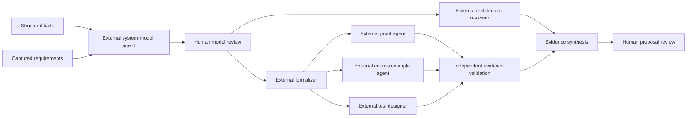

# Dependency-controlled analysis workflow

Each run is a DAG pinned to one captured source snapshot, documented specification
manifest, objective, and role-prompt version. Ready nodes can work in parallel.
Completed artifacts and events are immutable. A new source or specification
revision requires a new linked run.

Tracking: [issue #6](https://github.com/qzyu999/code-form/issues/6).
The implementation builds on the API/checker and walkthrough foundations.

## The graph



Facts and requirements are deterministic built-in controllers. Validation
resolves actual checker records, and synthesis assembles their evidence with
source-linked proposals and gaps. The external nodes expose role prompts and
API input contracts. **No model is called automatically by this implementation.**

External agents can use Codex or another configured model, but their work must
enter through the same pinned-context API. Task completion does not mean a
mathematical proposition was proved.

## Start and prepare a review

```powershell
.\.venv\Scripts\python.exe -m codeform serve --demo --workspace .. --data-dir .codeform/dag-review --port 7334
```

Open http://127.0.0.1:7334. Analyze a repository inside that workspace, then open
**Analysis DAG**. Create an objective. The UI runs ready read-only built-ins
and stops at the external system-model task.

An external agent reads that node's context and submits a source-linked draft.
The model gate then asks a human to review the exact artifact before releasing
architecture and formalization tasks. Neither a model gate nor the final
proposal gate approves a source edit, requirement amendment, merge, or deploy.

The inference-exchange review prepared during development uses the real
captured repository and a manual Codex source-analysis artifact. It contains
state definitions, source-linked billing/trust observations, proposed
mathematics, and a system diagram. Its first human gate remains unapproved.
The DAG explicitly shows that downstream agent tasks have not run.

The target's current semantics do not match the existing proof adapters.
Claims about billing or routing therefore remain proposed/inferred; there is
no implementation proof. This boundary must survive later synthesis.

## Python API sequence

```python
from codeform.client import CodeFormClient

c = CodeFormClient("http://127.0.0.1:7334")
analysis = c.wait(c.analyze("inference-exchange"))
snapshot = analysis["snapshot_id"]
run = c.create_workflow(snapshot, "Review product intent, state, and integrity.")
c.wait(c.advance_workflow(snapshot, run["id"]))
context = c.workflow_context(snapshot, run["id"], "model")
```

The context includes a role prompt, snapshot/specification/input hashes,
dependency artifacts, source API location, and existing fixed checker
obligations. Repository text remains untrusted data.

An external node submission includes:

```python
output = {
    "snapshot_id": snapshot,
    "spec_sha256": context["spec_sha256"],
    "input_sha256": context["input_sha256"],
    "actor": "external reasoning agent",
    "summary": "A source-linked model draft.",
    "claims": [{
        "statement": "A documented integrity property.",
        "status": "proposed",
        "latex": r"C=E+F",
        "evidence": [{
            "path": "docs/principles.md",
            "line_start": 31,
            "line_end": 33,
        }],
    }],
    "limitations": ["Formal implementation semantics have not been established."],
}
c.workflow_output(snapshot, run["id"], "model", output)
```

Substitute actual captured evidence. Every claim must have valid source ranges.
Agent claim statuses are observed, inferred, proposed, or unknown. Agents
cannot submit a prose claim with proved/disproved status.

Other optional fields include assumptions, test plans, existing proposal IDs,
selected fixed obligation IDs, and actual proof-attempt IDs. Structured
diagram nodes/edges generate an inspectable diagram and Mermaid source.
Strings are displayed as data, not executable code.

## Review the exact draft

The human gate names the reviewed artifact ID/hash, source snapshot, and
specification hash. Review notes do not mutate the model or requirement.

```python
run = c.workflow(snapshot, run["id"])
model = next(n for n in run["nodes"] if n["id"] == "model")["artifact"]
review = {
    "snapshot_id": snapshot,
    "spec_sha256": run["spec_sha256"],
    "artifact_id": model["id"],
    "artifact_sha256": model["sha256"],
    "actor": "local reviewer",
    "decision": "approved",
    "note": "Review reasoning for this exact draft.",
}
# Submit only after the reviewer has actually approved:
# c.workflow_review(snapshot, run["id"], "model_review", review)
```

Decisions are approved or needs_changes. Needs_changes preserves the run and
blocks downstream work. Create a new run with `parent_id` and, for another
snapshot, `parent_snapshot_id` to preserve feedback lineage.

The local shared token does not authenticate agent versus reviewer identities.
Actor names are provenance labels. Remote/multi-user operation would require
separate authentication and authorization.
The UI pins review forms to their snapshot, run, and artifact and removes stale
controls while switching snapshots.

## Parallel work and validation

After model review, architecture and formalization are ready independently.
After formalization, proof, counterexample, and test-design roles are ready
independently. The service rejects an output before its dependencies complete
or when snapshot/specification/input hashes differ.

Formalization can select existing fixed obligation IDs. Proof/counterexample
nodes may reference only real attempts for those selected obligations.
Validation reads checker status and declaration-binding evidence. It retains
unverified selected obligations and unsuccessful attempts.

Checked results concern their exact adapter scope. They do not prove every
statement in an external system model. A test plan is not a test execution.

Synthesis combines claims, checked evidence, proposed tests, and unresolved
limitations. It does not take a majority vote, silently strengthen hypotheses,
or call a successful agent response a proof.

## States and history

- ready: a built-in node's dependencies are complete.
- awaiting_agent: an external node needs an agent submission.
- awaiting_review: a human gate needs an exact-artifact decision.
- blocked: dependencies have not completed.
- running: a built-in task is active.
- complete: a task produced an immutable artifact; semantic truth is separate.
- needs_changes: a reviewer stopped the run.
- error: built-in work failed; no mathematical conclusion follows.
- interrupted: a prior process started work but did not complete it.
- superseded: a linked replacement explicitly retired the run; artifacts/events remain readable but new work is blocked.

On restart, interrupted built-in work can be advanced again. Earlier events
remain visible. External outputs and human decisions are immutable; revisions
belong in a new linked run.
For a replacement on the same snapshot, creation can set `supersede_parent:
true`. The parent remains readable but cannot accept new work or reviews.
The replacement needs its own review; parent approval is never carried over.

The complete run projection, role prompts, artifacts, hashes, and ordered
events can be exported from the UI. Records live under the data directory's
`agents/<snapshot_id>/workflows`, `workflow_artifacts`, and `workflow_events`
collections. Back up the full data directory.
Repeated snapshot reads use a bounded validated cache keyed by the actual
file-content hash. Changed content is revalidated, and callers get independent
copies. This avoids re-parsing large models for every DAG event/reference.

## Endpoints

```text
GET  /api/v1/workflow-templates
GET  /api/v1/snapshots/{snapshot}/workflows
POST /api/v1/snapshots/{snapshot}/workflows
GET  /api/v1/snapshots/{snapshot}/workflows/{run}
POST /api/v1/snapshots/{snapshot}/workflows/{run}/advance
GET  /api/v1/snapshots/{snapshot}/workflows/{run}/nodes/{node}/context
POST /api/v1/snapshots/{snapshot}/workflows/{run}/nodes/{node}/outputs
POST /api/v1/snapshots/{snapshot}/workflows/{run}/nodes/{node}/reviews
```

The same local JSON/token rules apply as in [api.md](api.md).
Advancement returns a job. A completed advancement job means ready built-in
work ended, not that the whole DAG or all obligations are complete.

The CLI exposes `api workflows SNAPSHOT`, `api workflow SNAPSHOT RUN`,
`api workflow-context SNAPSHOT RUN NODE`, `api workflow-create SNAPSHOT
--objective "..."`, and `api workflow-advance SNAPSHOT RUN --wait`.
Set the service URL before the action, for example
`python -m codeform api --url http://127.0.0.1:7334 workflows SNAPSHOT`.

## Current scope and extension points

The first template is fixed and validated as acyclic. External-role prompt
overrides are accepted at creation and pinned in the run. Arbitrary graph
templates, automatic model executors, budgeted model calls, agent cancellation,
isolated repair execution, and learned proof search remain future work.

Ready built-ins run in a bounded two-worker pool and do not execute target
code. Existing proof APIs retain their separate checker controls. The workflow
controller itself reads their evidence instead of accepting arbitrary Lean.

## Verification

```powershell
.\.venv\Scripts\python.exe -m unittest discover -s tests -v
node --check codeform/web/workflows.js
```

Tests exercise acyclicity, real parallel built-in execution, dependency/human
gates, immutable output, hash mismatches, interrupted work, source evidence,
validation, synthesis, and persistent history. Complete-run fixtures use
explicit fixture reviewers, not approval of the real inference-exchange draft.

With the Playwright setup in [testing.md](testing.md), run
`node tests/workflow-browser.cjs` against the prepared review server. It
inspects inference-exchange without approving it, then tests gate release on
an authored transfer fixture. Screenshots are under
`.codeform/browser-artifacts/inference-exchange-dag-review.png`.
